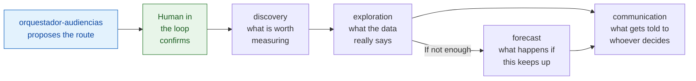
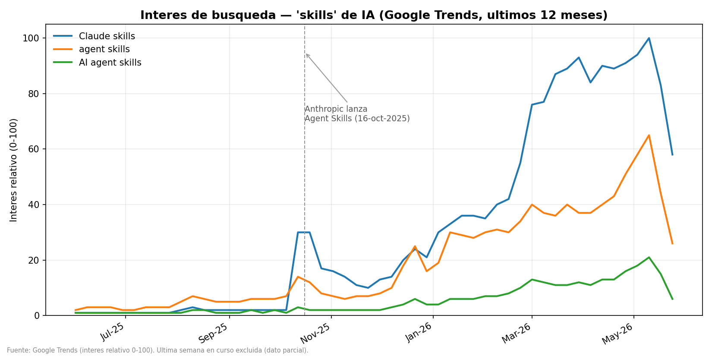

Versión en español: [README.md](README.md)

# audience-analyst-swarm

Five AI agents that share out the analysis of a digital audience: what to measure, what the data says, what will
happen and how to explain it to whoever decides. It is a proof of concept: the method of the accounting agents taken
to another trade.

**Case-study result:** with public Google Trends data, search interest in AI "skills" went from almost zero to its
peak in eight months, starting with the launch of Agent Skills in October 2025.

```bash
pip install -r requirements.txt
python estudio_skills/grafico_trends.py
```

It draws the case-study chart from the data already downloaded.

## The problem

A spike in visits can be a campaign that works or a bot, and a drop can be an audience leaving or a broken
measurement tag. Measuring an audience takes four jobs: deciding what to measure, checking the quality of what
arrives, forecasting and communicating. If one person does all four in one sitting, they reach the data with the
conclusion already formed. Splitting them forces an explicit handover from one to the next, and a handover can be
stopped.

## What is inside



Each **skill** is an instruction file read by a language model: its role, its steps, what it must not do and the
exact shape of its answer. The orchestrator proposes the route, waits for confirmation and calls the others; the
other four cannot fire on their own.

Every skill closes with a fixed block (`status`, `risk`, `skill_applied`) that says whether work can continue, how
much the finding matters and whether it followed its instructions. The handover rules are in `Result_Contract.md`.

The knowledge of the trade lives in `rag/RAG_Metricas_Audiencias.md`: benchmarks by channel with their source, the
rule that tells a bot from a campaign and a complete A/B testing method.

## The example



The orchestrator decides there is no need to forecast, because the question is about what happened. Discovery picks
three search terms and twelve months of weekly data; exploration checks no weeks are missing; communication writes
the headline. The starting hypothesis was a two-week spike, and the data showed an eight-month trend.

Google Trends publishes a relative index from 0 to 100, not a number of searches. That is why no exact multiplier is
given: the starting point is a rounded 1. The full study is in
[`estudio_skills/ESTUDIO_Skills_Tendencia.md`](estudio_skills/ESTUDIO_Skills_Tendencia.md) (in Spanish).

## How it was checked

The monthly averages were recomputed from the weekly series and match, leaving out the last week, which arrived
incomplete. The series has 53 weeks with no gaps and the three terms follow the same shape, with correlations of
0.95 and 0.98. The chart is drawn in a fresh environment installed only from `requirements.txt`.

## Limits

- The skills are text: they need a language model to read them. You cannot hand them a traffic file and get a
  report back.
- There is no test bench for the skills; they are judged by reading them.
- One source and one question. Search interest measures attention, not use.
- `trends_skills.py` downloads the data from Google again, and Google limits automated queries and may refuse. The
  data from the original download is in the repository.

## Files

| File | What it holds |
|---|---|
| `skills/` | the five skills |
| `rag/RAG_Metricas_Audiencias.md` | the knowledge of the trade |
| `Result_Contract.md` | the handover rules, with two examples |
| `arquitectura.md` | the design decisions |
| `estudio_skills/` | the case study: report, data, chart and the two scripts |

## Privacy

The case uses only public, aggregated Google Trends data, with no personal data.

## Related repositories

- [accounting-agent-swarm](https://github.com/jleonceo/accounting-agent-swarm): the accounting agents the method comes
  from.
- [orquestacion-enjambres-ia](https://github.com/jleonceo/orquestacion-enjambres-ia): how a system decides which agent
  handles each request.
- [gobernanza-skills-analiticas](https://github.com/jleonceo/gobernanza-skills-analiticas): the method for evaluating
  and improving skills.

---

*Part of [Juan Luis León](https://github.com/jleonceo)'s portfolio · [juanluisleon.vercel.app](https://juanluisleon.vercel.app) · Licence [MIT](LICENSE)*
