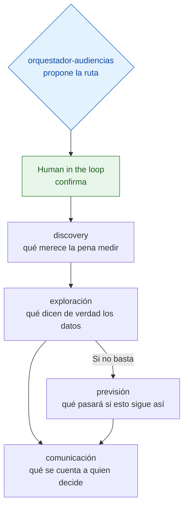

English version: [README.en.md](README.en.md)

# audience-analyst-swarm

Cinco agentes de IA que se reparten el análisis de una audiencia digital: qué medir, qué dicen los datos, qué
pasará y cómo contárselo a quien decide. Es una prueba de concepto: el mismo método de los agentes contables
llevado a otro oficio.

**Resultado del caso de estudio:** con datos públicos de Google Trends, el interés de búsqueda por las «skills» de
IA pasó de casi cero a su máximo en ocho meses, desde el lanzamiento de Agent Skills en octubre de 2025.

```bash
pip install -r requirements.txt
python estudio_skills/grafico_trends.py
```

Genera el gráfico del caso a partir de los datos ya descargados.

## El problema

Un pico de visitas puede ser una campaña que funciona o un robot, y una caída puede ser público que se va o una
etiqueta de medición rota. Medir una audiencia exige cuatro trabajos: decidir qué medir, comprobar la calidad de lo
que llega, proyectar y comunicar. Si los hace la misma persona de una sentada, llega a los datos con la conclusión
puesta. Repartirlos obliga a un relevo explícito entre uno y otro. Ese relevo se puede frenar.

## Qué hay dentro



Cada **skill** es un fichero de instrucciones que lee un modelo de lenguaje: su papel, sus pasos, lo que tiene
prohibido y la forma exacta de su respuesta. El orquestador propone la ruta, espera confirmación y llama a las
demás; las otras cuatro no pueden dispararse solas.

Cada skill cierra con un bloque fijo (`status`, `risk`, `skill_applied`) que dice si se puede seguir, cuánto
importa el hallazgo y si siguió sus instrucciones. Las reglas del relevo están en `Result_Contract.md`.

El conocimiento del oficio vive en `rag/RAG_Metricas_Audiencias.md`: valores de referencia por canal con su fuente,
la regla para separar un robot de una campaña y un método completo de test A/B.

## El ejemplo


El orquestador decide que no hace falta proyectar, porque la pregunta es qué ha pasado. Discovery elige tres
términos de búsqueda y doce meses de serie semanal; exploración comprueba que no faltan semanas; comunicación
escribe el titular. La hipótesis de partida era un repunte de dos semanas, y los datos enseñaron una tendencia de
ocho meses.

Google Trends publica un índice relativo de 0 a 100, no un número de búsquedas. Por eso no se da un multiplicador
exacto: el punto de partida es un 1 redondeado. El estudio completo está en
[`estudio_skills/ESTUDIO_Skills_Tendencia.md`](estudio_skills/ESTUDIO_Skills_Tendencia.md).

## Cómo se ha comprobado

Las medias mensuales se recalcularon desde la serie semanal y coinciden, sin la última semana, que llegó
incompleta. La serie tiene 53 semanas sin huecos y los tres términos siguen la misma forma, con correlaciones de
0,95 y 0,98. El gráfico se genera en un entorno nuevo instalado solo con `requirements.txt`.

## Límites

- Las skills son texto: hace falta un modelo de lenguaje que las lea. No se le puede pasar un fichero de visitas y
  recibir un informe.
- No hay banco de pruebas de las skills; se juzgan leyéndolas.
- Una sola fuente y una sola pregunta. El interés de búsqueda mide atención, no uso.
- `trends_skills.py` vuelve a descargar los datos de Google, que limita las consultas automáticas y puede negarse.
  Los datos de la descarga original están en el repositorio.

## Ficheros

| Fichero | Qué contiene |
|---|---|
| `skills/` | las cinco skills |
| `rag/RAG_Metricas_Audiencias.md` | el conocimiento del oficio |
| `Result_Contract.md` | las reglas del relevo, con dos ejemplos |
| `arquitectura.md` | las decisiones de diseño |
| `estudio_skills/` | el caso de estudio: informe, datos, gráfico y los dos scripts |

## Privacidad

El caso usa solo datos públicos y agregados de Google Trends, sin datos personales.

## Repositorios relacionados

- [accounting-agent-swarm](https://github.com/jleonceo/accounting-agent-swarm): los agentes contables de los que sale
  el método.
- [orquestacion-enjambres-ia](https://github.com/jleonceo/orquestacion-enjambres-ia): cómo se decide a qué agente va
  cada petición.
- [gobernanza-skills-analiticas](https://github.com/jleonceo/gobernanza-skills-analiticas): el método para evaluar y
  mejorar skills.

---

*Parte del portfolio de [Juan Luis León](https://github.com/jleonceo) · [juanluisleon.vercel.app](https://juanluisleon.vercel.app) · Licencia [MIT](LICENSE)*
