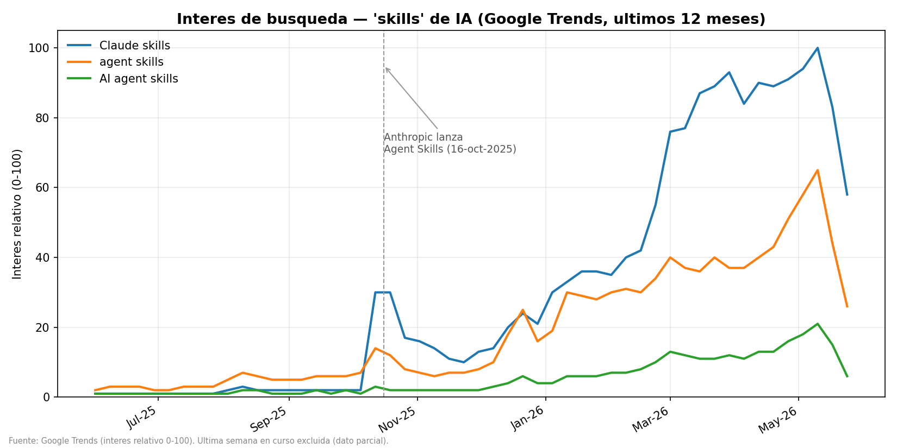

# audience-analyst-swarm

**Cinco agentes de IA especializados que se reparten el análisis de una audiencia digital**
**Five specialized AI agents that share out the analysis of a digital audience**

[Español](#español) · [English](#english)

---

## Español

### El problema

Lunes por la mañana. El tráfico de la web se ha triplicado durante el fin de semana y en la reunión
se felicita a quien lanzó la campaña. Tres semanas más tarde alguien mira aquel fin de semana de
cerca: las visitas duraban cuatro segundos, entraron todas por el mismo sitio y ninguna compró
nada. Aquello no era público: era un robot.

La avería contraria pasa igual de callada. Caen las visitas un cuarenta por ciento de un día para
otro, cunde el pánico y se recorta presupuesto. Lo que había cambiado era una etiqueta de medición:
el público seguía ahí y dejó de contarse.

Medir una audiencia parece un trabajo y son cuatro. Hay que decidir qué merece la pena medir antes
de tener un solo dato, limpiar lo que llega para entender qué dice de verdad, proyectar hacia
delante cuando la pregunta mira al futuro, y contárselo a quien decide, que casi nunca es quien
mide.

¿Por qué no basta con un único ayudante que haga los cuatro trabajos? Porque tiran en direcciones
distintas. Quien tiene que entregar un informe convincente el viernes es la peor persona para
juzgar el lunes si los datos merecen confianza. No hace falta mala fe para que salga mal: cuando
una misma cabeza recorre los cuatro pasos de una sentada, llega a los datos con la conclusión ya
puesta y encuentra lo que iba buscando. Así es como un pico de robots acaba contado como éxito,
porque encajaba con la campaña que había que defender.

Repartir esos cuatro trabajos obliga a que el paso de uno al siguiente sea explícito. Y un paso
explícito se puede frenar.

### Qué hay en este repositorio

Diecisiete ficheros, y ninguno de ellos arranca nada: lo que se publica aquí son instrucciones.

Una **skill** es una hoja de instrucciones permanente que se le pone delante a un programa de
inteligencia artificial de los que responden por escrito: qué papel juega, qué pasos sigue en qué
orden, qué tiene prohibido y con qué forma exacta entrega el resultado. Un **enjambre** son varias
skills que se reparten un oficio y se pasan el trabajo entre ellas. Aquí hay cinco: los cuatro
trabajos del apartado anterior más quien los coordina.

Cinco documentos describen cómo debe trabajar cada especialista, un sexto guarda el conocimiento del
oficio, un séptimo fija las reglas del relevo, y un caso de estudio con datos públicos reales enseña
el conjunto en marcha.

Conviene entender la apuesta antes de seguir leyendo. Su autor viene de construir sistemas de
agentes de inteligencia artificial y no del análisis de audiencias; este repositorio existe para
demostrar que el mismo armazón se traslada a un oficio nuevo en cuestión de días. Es una prueba de
concepto y no una herramienta de producción.

### Las cinco skills

```
orquestador-audiencias
   └── discovery-audiencias      qué merece la pena medir
   └── exploracion-audiencias    qué dicen de verdad los datos que llegan
   └── prevision-audiencias      qué pasará si esto sigue así
   └── comunicacion-audiencias   qué se le cuenta a quien decide
```

El orquestador no analiza nada. Diagnostica qué hace falta, propone la ruta en voz alta, espera
confirmación y va llamando a las demás en el orden que haya trazado. Las otras cuatro llevan escrito
en su cabecera `disable-model-invocation: true`, que significa que tienen prohibido dispararse
solas. Nadie entra a proyectar sin que antes alguien haya explorado.

Las instrucciones obligan a cosas concretas. La de exploración manda recorrer seis capas de lectura
y coloca la calidad del dato en la segunda, antes de calcular ninguna métrica. La de definición pone
un tope de siete indicadores por etapa, con el argumento de que medir treinta cosas es no haber
elegido ninguna.

### El conocimiento del oficio

**RAG** son las iniciales de una técnica cuyo nombre inglés significa «generación apoyada en
documentos recuperados». En la práctica es un fichero de consulta: el conocimiento del oficio,
escrito aparte, que las skills abren cuando lo necesitan.

Trae los valores de referencia del sector con su fuente y su fecha, que es lo que permite decir si
un 1,8 % de conversión está bien o mal según el canal. Trae también la tabla que separa un robot de
una campaña de verdad: rebote por encima de 0,95 **y** duración por debajo de cinco segundos **y**
cero conversiones. Basta con que una de las tres condiciones no se cumpla para que sea tráfico
humano de mala calidad, y entonces se dice así, con sus conversiones delante. Exige además que la
cifra publicada sea la neta, o sea las sesiones del día del pico menos la media del canal en días
normales, porque el bruto convierte cualquier anomalía en un récord.

Esa tabla es la respuesta al lunes por la mañana del primer apartado.

### El relevo entre especialistas

Cada skill cierra su respuesta con un bloque de campos fijos, de los cuales tres importan:

```
status: OK | WARN | BLOCKED | ERROR
risk: LOW | MEDIUM | HIGH | CRITICAL
skill_applied: true | false
```

El primero dice si se puede continuar y el segundo cuánto quema el hallazgo. El tercero es el más
raro de los tres, porque declara si el agente siguió sus instrucciones o improvisó por su cuenta.
Cuando ese campo sale falso una y otra vez en el mismo tipo de caso, el problema no está en el
agente: está en unas instrucciones que nadie puede seguir.

El propio repositorio pone un ejemplo con una medición que se rompió a mitad de febrero, dejando
válido el análisis anterior e inservible el posterior. Sin ese bloque, el especialista siguiente
coge los datos malos, proyecta sobre ellos y la decisión se toma antes de que nadie se entere.

### El ejemplo: cuánta atención están captando las «skills» de IA

El caso de estudio incluido responde a una pregunta real y se contesta en cinco pasos. En el primero
de ellos, el enjambre decide no hacer una cuarta parte del trabajo.

1. **El orquestador diagnostica.** Hay pregunta y hay fuente disponible, así que traza la ruta y
   decide que aquí **no se proyecta**, porque lo que se pregunta es qué ha pasado y no qué pasará.
2. **Discovery elige el indicador.** Interés de búsqueda como aproximación a la atención pública,
   tres términos concretos para esquivar el ruido de la palabra «skills» en su sentido corriente,
   doce meses de ventana y resolución semanal. Con su nota de privacidad: dato público y agregado,
   sin ninguna persona detrás.
3. **Exploración lee la serie.** Cincuenta y tres semanas, tres columnas, cero huecos y ninguna
   semana perdida.
4. **Previsión se queda fuera**, tal como se decidió en el primer paso.
5. **Comunicación escribe el titular**, con lo que funciona, lo que hay que matizar y una
   recomendación.



Conviene saber qué se está mirando en ese gráfico. Google Trends no publica cuántas búsquedas hubo:
publica un índice **relativo**, que reparte de 0 a 100 dentro de la comparación que le pidas, de
modo que el 100 es el punto más alto de esa consulta concreta y todo lo demás se mide contra él. Un
1 no significa una búsqueda: significa la centésima parte del máximo después de redondear.

Lo que el autor destaca del resultado es que se equivocaba. Entró esperando una curva plana con un
repunte de dos semanas, y los datos enseñaron una tendencia de ocho meses que arranca con el
lanzamiento de Agent Skills en octubre de 2025. Publicó la corrección tal cual, que es lo que su
skill de comunicación le obliga a hacer.

Estudio completo: [`estudio_skills/ESTUDIO_Skills_Tendencia.md`](estudio_skills/ESTUDIO_Skills_Tendencia.md).

### Qué está medido

Ejecutado el 22/07/2026 con Python 3.14.6 sobre los datos del propio repositorio:

| Comprobación | Resultado |
|---|---|
| El resumen mensual recalculado desde el fichero semanal | idéntico al publicado, diferencia máxima 0,0 |
| Estructura de la serie | 53 semanas, 3 términos, 0 nulos, sin saltos |
| El arranque de la subida | semana del 12 de octubre de 2025, de 2 a 30 en siete días |
| Duración de la tendencia de octubre a mayo | 8 meses, como dice el estudio |
| Los tres términos siguen la misma forma | correlación de 0,95 y 0,98; se sostiene |
| `grafico_trends.py` | se para con un error y no genera nada |
| `trends_skills.py` | Google responde 429 y no descarga |

### Lo que esa revisión dejó peor de lo que estaba

Esta portada decía antes que el interés se multiplicó «~×80». La revisión del 22/07/2026 manda sobre
esa cifra, y lo que dice es que no tiene un solo valor. Según qué dos números se dividan sale ×100
(semana más alta contra el suelo), ×88,5 (mes más alto) o ×78,6 (último mes). Hay algo peor que esa
horquilla: el suelo del que se parte es un 1, y un 1 en este índice es cualquier valor entre 0,5 y
1,5 antes de redondear. Con el mismo dato exacto, el multiplicador honesto va **de ×67 a ×200**. La
cifra grande descansa entera sobre el número más pequeño y menos preciso de la tabla.

**El único programa que dibuja no se ejecuta.** Su última línea intenta juntar una ruta con un texto
de una forma que Python ya no admite:

```
TypeError: unsupported operand type(s) for +: 'WindowsPath' and 'str'
```

Se calcula el gráfico entero y se pierde al ir a guardarlo. Corregida esa línea en una copia, sale
una imagen idéntica byte a byte a la publicada, así que el defecto cabe en una línea y el dibujo sí
corresponde a los datos. Lo que hace el caso digno de contar es de dónde vino. Introdujo la avería
el mismo commit que quitaba del código las rutas del disco de su autor, para que el repositorio
funcionase en cualquier máquina. Ese commit afirma por escrito «verificado: los 3 ficheros
compilan», y compilan de verdad, comprobado uno por uno al revisar el repositorio. Compilar no es
ejecutar.

**Mayo mezcla una semana incompleta.** El programa del gráfico descarta a propósito la última semana
por estar en curso, mientras el fichero de medias mensuales la incluye. Mayo vale 78,6 con ella y
83,75 sin ella, de modo que la corrección desde el pico que el informe subraya pasa de un 11,2 % a
un 5,4 %. Dos ficheros del mismo repositorio tratan el mismo dato de dos maneras.

**Dos afirmaciones se quedan sin respaldo posible aquí.** Una es el reparto «~70 % reutilizado,
~30 % nuevo», que no se puede comprobar en este repositorio porque el enjambre del que se reutiliza
no está dentro. Medido por lo único medible, las cinco skills y el fichero de oficio suman el 57 %
de las palabras del conjunto. La otra es la cifra que sostiene la conclusión del estudio, «el top 3
de skills acapara ~99 % de la atención», que no sale de ningún dato publicado aquí, en un enjambre
cuya regla número tres es que toda cifra lleve fuente.

### Cuándo no sirve

**No hay nada que ejecutar.** Las cinco skills son texto, y hace falta un programa de inteligencia
artificial que las lea y las obedezca. Quien clone esto no puede pasarle un fichero de visitas y
recibir un informe.

**No hay con qué comprobar que funcionan.** El método de evaluación se reutiliza del enjambre
hermano, cosa que puede ser cierta allí. Aquí no hay una sola prueba: cero ficheros de examen en los
diecisiete. Un enjambre de cinco piezas sin banco de pruebas solo se puede juzgar leyéndolo.

**Una sola fuente y una sola pregunta.** El estudio lo declara con todas las letras. Esta portada
anunciaba antes datos de «Google Trends, GitHub». De GitHub no hay ni una fila en todo el
repositorio, y la mención se ha retirado.

**Interés de búsqueda no es adopción.** Que se busque mucho un tema dice que hay atención, no que se
esté usando.

### Qué llevarse

**Repartir el trabajo sirve para poder frenarlo.** Cinco especialistas no analizan mejor que uno por
el hecho de ser cinco. Sirven porque entre uno y el siguiente hay un relevo escrito que puede decir
BLOCKED, mientras que en un solo agente ese relevo ocurre dentro de una cabeza que nadie ve.

**Una cifra vale lo que valga su divisor.** El ×80 de esta portada parecía la medición más sólida
del estudio y resultó ser la más frágil, porque divide entre un 1 redondeado.

**Compilar no es ejecutar.** El fichero que dibuja el gráfico pasa la comprobación que su autor
eligió y falla al usarlo. La única prueba de que algo funciona es haberlo puesto a funcionar.

### Privacidad

El caso de estudio usa **solo datos públicos y agregados** de Google Trends. Sin datos personales ni
perfilado: el uso de IA aquí es libre de RGPD. Las skills saben dónde está la línea entre dato
*público o agregado* (libre) y *personal* (RGPD y ePrivacy).

### Qué abrir y en qué orden

| Orden | Fichero | Qué encontrarás |
|---|---|---|
| 1 | `estudio_skills/ESTUDIO_Skills_Tendencia.md` | El enjambre entero en marcha sobre una pregunta real |
| 2 | `Result_Contract.md` | Las reglas del relevo con dos ejemplos |
| 3 | `rag/RAG_Metricas_Audiencias.md` | El oficio: referencias por canal, robots y tests A/B |
| 4 | `skills/orquestador-audiencias/SKILL.md` | Quién reparte el trabajo |
| 5 | `skills/exploracion-audiencias/SKILL.md` | Las seis capas de lectura de un dato |
| 6 | `estudio_skills/google_trends_skills_semanal.csv` | Las cifras en crudo; se abre con Excel |

Si vienes de marketing y solo vas a abrir uno, que sea el tercero: su apartado 11 es un método
completo de test A/B con los siete errores que invalidan uno.

### Estructura

```
audience-analyst-swarm/
  README.md
  arquitectura.md          decisiones de diseño
  Result_Contract.md       cómo cierra cada skill para que el orquestador la entienda
  rag/
    RAG_Metricas_Audiencias.md    métricas y valores de referencia, con fuente
  skills/                  las 5 skills (español)
    orquestador-audiencias/
    discovery-audiencias/
    exploracion-audiencias/
    prevision-audiencias/
    comunicacion-audiencias/
  estudio_skills/          caso de estudio
    ESTUDIO_Skills_Tendencia.md
    grafico_tendencia_skills.png
    trends_skills.py · grafico_trends.py
    google_trends_skills_*.csv
```

### Repos relacionados

Este enjambre es el mismo método aplicado a otro dominio; estas son las piezas hermanas del
portfolio:

- [accounting-agent-swarm](https://github.com/jleonceo/accounting-agent-swarm): el enjambre contable del que sale el método, con su evaluación continua.
- [orquestacion-enjambres-ia](https://github.com/jleonceo/orquestacion-enjambres-ia): el enrutado, cómo se decide a qué agente va cada petición sin romperse al crecer.
- [gobernanza-skills-analiticas](https://github.com/jleonceo/gobernanza-skills-analiticas): el método que gobierna estos enjambres, con golden sets y puertas de no-regresión.
- [verificacion-determinista-ia](https://github.com/jleonceo/verificacion-determinista-ia): el guardarraíl que recomprueba la coherencia de los datos sin IA.
- [agent-memory-governance](https://github.com/jleonceo/agent-memory-governance): que la memoria del agente no se convierta en un vertedero.
- [llm-eval-contable](https://github.com/jleonceo/llm-eval-contable): de dónde nace todo, la evaluación de una sola skill.

---

## English

### The problem

Monday morning. Website traffic tripled over the weekend, and in the meeting everyone congratulates
whoever launched the campaign. Three weeks later someone looks at that weekend closely: the visits
lasted four seconds, they all came in through the same door and none of them bought anything. That
was not an audience: it was a bot.

The opposite failure is just as quiet. Traffic drops forty per cent overnight, panic spreads and
budget gets cut. What had changed was a measurement tag: the audience was still there and had
stopped being counted.

Measuring an audience looks like one job and it is four. You have to decide what is worth measuring
before you have a single figure, clean what arrives so you can tell what it really says, project
forward when the question is about the future, and explain it to whoever decides, who is almost
never the person doing the measuring.

Why is one assistant doing all four not enough? Because the four jobs pull in different directions
and answer to different incentives. Whoever has to deliver a convincing report on Friday is the worst person to judge on Monday whether
the data deserves any trust. Bad faith is not required for this to go wrong: when the same head
walks the four steps in one sitting, it reaches the data with the conclusion already formed and
finds what it went looking for. That is how a spike of bot traffic ends up filed as a success,
because it fitted the campaign that had to be defended.

Splitting those four jobs forces the handover from one to the next to be explicit. And an explicit
step can be stopped.

### What is in this repository

Seventeen files, and none of them runs anything: what is published here is instructions.

A **skill** is a permanent instruction sheet placed in front of a text-answering artificial
intelligence program: what role it plays, what steps it follows in what order, what it is forbidden
to do, and the exact shape in which it hands over its result. A **swarm** is several skills that
share out a trade and pass the work between them. There are five here: the four jobs from the
section above plus the one that coordinates them.

Five documents describe how each specialist must work, a sixth holds the knowledge of the trade, a
seventh sets the handover rules, and a case study with real public data shows the whole thing in
motion.

It is worth understanding the bet before reading on. Its author comes from building artificial
intelligence agent systems and not from audience analytics; this repository exists to show that the
same frame can be carried to a new trade in a matter of days. It is a proof of concept and not a
production tool.

### The five skills

```
orquestador-audiencias
   └── discovery-audiencias      what is worth measuring
   └── exploracion-audiencias    what the incoming data actually says
   └── prevision-audiencias      what happens if this keeps up
   └── comunicacion-audiencias   what gets told to whoever decides
```

The orchestrator analyses nothing. It diagnoses what is needed, proposes the route out loud, waits
for confirmation and calls the others in the order it has drawn. The other four carry
`disable-model-invocation: true` in their header, which means they are forbidden to fire on their
own. Nobody gets to start forecasting before somebody else has explored the data first.

The instructions force concrete things. The exploration one requires six reading layers and puts
data quality in the second, before any metric is calculated. The definition one caps indicators at
seven per stage, on the grounds that measuring thirty things means you have chosen none.

### The knowledge of the trade

**RAG** stands for retrieval-augmented generation. In practice it is a reference file: the knowledge
of the trade, written apart, which the skills open when they need it.

It carries the sector benchmarks with their source and their date, which is what lets you say
whether a 1.8% conversion rate is good or bad for a given channel. It also carries the table that
tells a bot apart from a real campaign: bounce above 0.95 **and** duration below five seconds
**and** zero conversions. If any one of the three conditions fails, it is poor-quality human traffic
and gets described that way, with its conversions in plain sight. It also demands that the published
figure be the net one, meaning the sessions on the peak day minus the channel average on normal
days, because the gross figure turns any anomaly into a record.

That table is the answer to the Monday morning of the first section.

### The handover between specialists

Every skill closes its answer with a block of fixed fields, three of which matter:

```
status: OK | WARN | BLOCKED | ERROR
risk: LOW | MEDIUM | HIGH | CRITICAL
skill_applied: true | false
```

The first says whether work can continue and the second how much the finding burns. The third is the
odd one, because it declares whether the agent followed its instructions or improvised. When that
field comes back false over and over in the same kind of case, the problem is not the agent: it is
instructions nobody can follow.

The repository includes an example with a measurement that broke in mid-February, leaving the
earlier analysis valid and the later one useless. Without that block, the next specialist picks up
the bad data, projects on top of it and the decision is made before anyone finds out.

### The example: how much attention AI "skills" are drawing

The included case study answers a real question in five steps. In the first one, the swarm decides
not to do a quarter of the work.

1. **The orchestrator diagnoses.** There is a question and there is a source, so it draws the route
   and decides that **nothing is forecast** here, because what is being asked is what happened and
   not what will happen.
2. **Discovery picks the indicator.** Search interest as a proxy for public attention, three
   specific terms to dodge the noise of the everyday meaning of "skills", a twelve-month window and
   weekly resolution. With its privacy note: public, aggregated data with no person behind it.
3. **Exploration reads the series.** Fifty-three weeks, three columns, zero gaps and no missing
   week.
4. **Forecasting stays out**, as decided in step one.
5. **Communication writes the headline**, with what works, what needs qualifying and one
   recommendation.


It helps to know what that chart is showing before reading anything into it. Google Trends does not
publish how many searches there were. It publishes a **relative** index, spread from 0 to 100 inside
the comparison you asked for, so 100 is the highest point of that specific query and everything else
is measured against it. A 1 does not mean one search: it means one hundredth of the maximum after
rounding.

What the author highlights about the result is that he was wrong. He went in expecting a flat curve
with a two-week spike, and the data showed an eight-month trend starting with the launch of Agent
Skills in October 2025. He published the correction as it was, which is what his communication skill
obliges him to do.

Full study: [`estudio_skills/ESTUDIO_Skills_Tendencia.md`](estudio_skills/ESTUDIO_Skills_Tendencia.md).

### What has been measured

Executed on 22/07/2026 with Python 3.14.6 against the repository's own data:

| Check | Result |
|---|---|
| Monthly summary recomputed from the weekly file | identical to the published one, max difference 0.0 |
| Structure of the series | 53 weeks, 3 terms, 0 nulls, no jumps |
| Start of the rise | week of 12 October 2025, from 2 to 30 in seven days |
| Length of the trend from October to May | 8 months, as stated |
| The three terms share the same shape | correlation of 0.95 and 0.98; it holds |
| `grafico_trends.py` | stops with an error and produces nothing |
| `trends_skills.py` | Google answers 429 and nothing downloads |

### What that review left in worse shape than it found it

This page used to say that interest multiplied "~80×". The review of 22/07/2026 overrides that
figure, and what it says is that the figure has no single value. Depending on which two numbers you
divide, you get 100× (highest week against the floor), 88.5× (highest month) or 78.6× (last month).
There is something worse than that spread: the floor it starts from is a 1, and a 1 in this index is
any value between 0.5 and 1.5 before rounding. With exactly the same data, the honest multiplier
runs **from 67× to 200×**. The big figure rests entirely on the smallest and least precise number in
the table.

**The only program that draws anything does not run.** Its last line tries to join a path to a piece
of text in a way Python no longer allows:

```
TypeError: unsupported operand type(s) for +: 'WindowsPath' and 'str'
```

The whole chart is computed and then lost on the way to saving it. With that line fixed in a copy,
the image that comes out is byte-for-byte identical to the published one, so the defect fits in one
line and the drawing does match the data. What makes the case worth telling is where it came from.
The failure was introduced by the very commit that stripped the author's local disk paths out of the
code so the repository would work on any machine. That commit states in writing "verified: the 3
files compile", and they do compile, checked one by one during the review. Compiling is not running.

**May mixes in an incomplete week.** The chart program deliberately drops the last week because it
is still in progress, while the monthly averages file includes it. May is 78.6 with it and 83.75
without it, so the correction from the peak that the study underlines moves from 11.2% to 5.4%. Two
files in the same repository treat the same data in two different ways.

**Two claims have no possible backing here.** One is the "~70% reused, ~30% new" split, which cannot
be checked in this repository because the swarm being reused is not inside it. Measured by the only
measurable thing, the five skills and the trade file account for 57% of the words in the set. The
other is the figure holding up the study's conclusion, "the top 3 skills take ~99% of the
attention", which comes from no data published here, in a swarm whose rule number three is that
every figure carries its source.

### When it is not the right tool

**There is nothing to run.** The five skills are text, and they need an artificial intelligence
program to read them and obey them. Whoever clones this cannot hand it a traffic file and get a
report back.

**There is nothing here to check that they work.** The evaluation method is reused from the sibling
swarm, which may well be true over there. Here there is not a single test: zero exam files among the
seventeen. A five-piece swarm with no test bench can only be judged by reading it.

**One source and one question.** The study states this in full. This page used to announce data from
"Google Trends, GitHub". There is not one row of GitHub data in the whole repository, so the mention
has been removed.

**Search interest is not adoption.** Heavy searching for a topic says there is attention, not that
anything is being used.

### What to take away

**Splitting the work is what makes it stoppable.** Five specialists do not analyse better than one
by virtue of being five. They work because between one and the next there is a written handover that
can say BLOCKED, whereas in a single agent that handover happens inside one head that nobody sees.

**A figure is worth whatever its divisor is worth.** The 80× on this page looked like the study's
most solid measurement and turned out to be its most fragile one, because it divides by a rounded 1.

**Compiling is not running.** The file that draws the chart passes the check its author chose and
fails when used. The only proof that something works is having made it work.

### Privacy

The case study uses **only public, aggregated data** from Google Trends. No personal data, no
profiling: AI use here is free of GDPR constraints. The skills know where the line sits between
*public or aggregated* data (free) and *personal* data (GDPR and ePrivacy).

### What to open and in what order

| Order | File | What you will find |
|---|---|---|
| 1 | `estudio_skills/ESTUDIO_Skills_Tendencia.md` | The whole swarm at work on a real question |
| 2 | `Result_Contract.md` | The handover rules with two examples |
| 3 | `rag/RAG_Metricas_Audiencias.md` | The trade: benchmarks by channel, bots and A/B tests |
| 4 | `skills/orquestador-audiencias/SKILL.md` | Who hands out the work |
| 5 | `skills/exploracion-audiencias/SKILL.md` | The six reading layers of a data point |
| 6 | `estudio_skills/google_trends_skills_semanal.csv` | The raw figures; opens in Excel |

If you come from marketing and will only open one, make it the third: its section 11 is a complete
A/B testing method with the seven mistakes that invalidate one.

### Structure

```
audience-analyst-swarm/
  README.md
  arquitectura.md          design decisions
  Result_Contract.md       how each skill signs off so the orchestrator can read it
  rag/
    RAG_Metricas_Audiencias.md    metrics and benchmarks, with sources
  skills/                  the 5 skills (in Spanish)
    orquestador-audiencias/
    discovery-audiencias/
    exploracion-audiencias/
    prevision-audiencias/
    comunicacion-audiencias/
  estudio_skills/          case study
    ESTUDIO_Skills_Tendencia.md
    grafico_tendencia_skills.png
    trends_skills.py · grafico_trends.py
    google_trends_skills_*.csv
```

### Related repositories

This swarm is the same method applied to a different domain; these are its sibling projects in the
portfolio:

- [accounting-agent-swarm](https://github.com/jleonceo/accounting-agent-swarm): the accounting swarm the method comes from, with its continuous evaluation.
- [orquestacion-enjambres-ia](https://github.com/jleonceo/orquestacion-enjambres-ia): the routing, how a system decides which agent handles each request without breaking as it grows.
- [gobernanza-skills-analiticas](https://github.com/jleonceo/gobernanza-skills-analiticas): the method that governs these swarms, with golden sets and no-regression gates.
- [verificacion-determinista-ia](https://github.com/jleonceo/verificacion-determinista-ia): the guardrail that rechecks the coherence of the data without AI.
- [agent-memory-governance](https://github.com/jleonceo/agent-memory-governance): keeping the agent's memory from turning into a junkyard.
- [llm-eval-contable](https://github.com/jleonceo/llm-eval-contable): where it all started, the evaluation of a single skill.

---

*audience-analyst-swarm · prueba de concepto / proof of concept · 04/06/2026 · Licencia / License: [MIT](LICENSE)*
