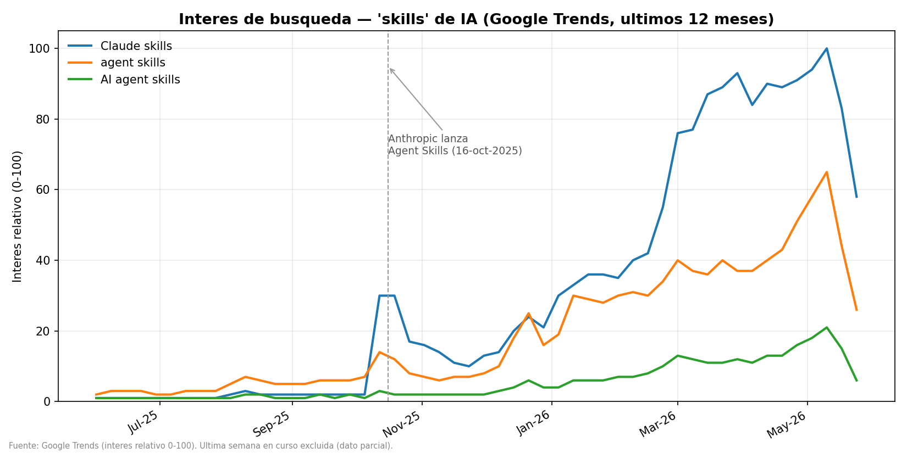

# Caso de estudio: El auge de las "skills" de IA

*Demostración del enjambre Analista de Audiencias sobre datos reales · 04/06/2026*

---

## Por qué este estudio

Este repositorio es una **prueba de método**: coger una infraestructura de agentes IA ya
validada en otros dominios y aplicarla a uno nuevo (análisis de audiencias) para responder una
pregunta real con datos públicos.

La pregunta: **¿cuánta atención está captando el concepto de "skills" de IA, y desde cuándo?**
Es un caso 100% de analista de audiencias (medir el interés del público por un tema) y, a la
vez, mide algo que llevo dos meses construyendo. El caso es, en sí mismo, la prueba.

> **Honestidad por delante:** entré con una hipótesis ("estuvo plano todo el año y repuntó en
> las últimas 2 semanas") y **los datos la corrigieron**. Lo cuento tal cual. Ese es el punto:
> en análisis, los datos mandan sobre la intuición.

---

## Cómo lo produjo el enjambre (las 5 skills en acción)

### 1. `orquestador-audiencias`: diagnóstico
Entrada: una pregunta de negocio ("¿el interés por las skills sube?") + una fuente de datos
disponible (Google Trends). Ruta trazada: **Discovery → Exploración → Comunicación**. Sin
previsión (la pregunta es descriptiva: "¿qué ha pasado?", no "¿qué pasará?").

### 2. `discovery-audiencias`: qué medir
- **Objetivo:** cuantificar la atención pública al concepto de "skills" de IA y su evolución.
- **KPI:** interés de búsqueda relativo (Google Trends, 0–100) como **proxy de atención pública**.
- **Términos:** `Claude skills`, `agent skills`, `AI agent skills` (específicos, para evitar el ruido de "skills" = habilidades genéricas).
- **Ventana:** 12 meses, resolución semanal, para ver la forma de la curva, no solo el final.
- **Privacidad:** dato público y agregado. Sin datos personales. Uso libre.

### 3. `exploracion-audiencias`: qué dicen los datos
**Estructura:** serie semanal, 3 términos, jun-2025 a jun-2026. Fuente: Google Trends (vía `pytrends`).

**Calidad:** sin huecos; valores normalizados 0–100 por diseño de Trends. Señal limpia.

**Hallazgos (media mensual, "Claude skills"):**

| Periodo | Índice | Lectura |
|---|---|---|
| jun–sep 2025 | 1–2 | Plano, casi inexistente |
| **oct 2025** | **19,8** | Primer salto (×10) — coincide con el lanzamiento de Agent Skills (16-oct-2025) |
| dic 2025 | 19,8 | Segundo impulso (estándar abierto, 18-dic) |
| ene–feb 2026 | 33,8 → 43,0 | Aceleración |
| mar–abr 2026 | 84,4 → 88,5 | Explosión, pico |
| may 2026 | 78,6 | Corrección desde el pico |

**Corrección de la hipótesis inicial (lo importante):**
- No estuvo "plano todo el año": plano solo jun–sep 2025.
- El repunte no es de "las últimas 2 semanas": la subida arranca en **oct-2025** y es una tendencia de **~8 meses**. De hecho, las últimas semanas **bajan** desde el pico de inicios de mayo.
- Lo que sí es rotundo: el interés se multiplicó **~×80** desde el suelo. El fenómeno es real y grande.

### 4. `comunicacion-audiencias`: el informe

> ## Titular
> **El interés por las "skills" de IA se multiplicó por ~80 en ocho meses, impulsado por el lanzamiento de Agent Skills de Anthropic (oct-2025), con su pico en abril–mayo de 2026.**
>
> ## Qué está funcionando (señal)
> - Despegue claro y sostenido desde oct-2025; no es ruido puntual, es tendencia estructural.
> - `Claude skills` lidera; `agent skills` y `AI agent skills` acompañan con la misma forma.
>
> ## Qué matizar
> - El pico ya pasó (inicios de mayo); las últimas semanas corrigen a la baja. Conviene vigilar si se estabiliza en una meseta alta o sigue bajando.
> - "Interés de búsqueda" es un proxy de atención, no una medida directa de adopción.
>
> ## Recomendación
> Para una marca/medio del sector IA: el tema tiene tracción alta pero ya madura. **El alfa de "hablar de skills" ya se consumió** — el pico de descubrimiento fue ene–abr 2026.
>
> Lo que sigue abierto es otra cosa. La adopción está **concentradísima** (el top 3 de skills acapara ~99% de la atención; el resto busca audiencia): la huella de un ecosistema con **mucho contenido superficial y poquísimo de profundidad**. Lo que escasea es el **razonamiento, la estructura y la evaluación** (evals, gobernanza) — el *cómo se construye una skill que de verdad funcione*, no el *qué es*. Ese hueco está abierto. **Ahí está el alfa que queda: no llegar antes a un tema, sino llegar más hondo.**

---

## Limitaciones (honestas)
- **Google Trends mide interés de búsqueda**, un proxy de atención: no mide adopción real ni volumen absoluto (la escala es relativa 0–100).
- La elección de términos condiciona el resultado; se eligieron los más específicos para reducir ruido.
- Una sola fuente. Para un estudio de cliente se cruzaría con GitHub, redes y volumen de contenido.

## Privacidad
Datos **públicos y agregados** (Google Trends). Sin datos personales, sin perfilado. Uso de IA sin restricción de RGPD.

## Reproducibilidad
- `trends_skills.py`: descarga la serie (pytrends) y guarda CSV.
- `grafico_trends.py`: genera el gráfico desde el CSV.
- `google_trends_skills_semanal.csv` / `_mensual.csv`: datos.

---

*Caso de estudio · enjambre Analista de Audiencias · 04/06/2026 · datos: Google Trends*
